# OMNICART

**10 demonic-neon arcade games. One cursed cartridge.**

Vite + TypeScript · Canvas 2D + Three.js · lazy-loaded games · procedural Web Audio · keyboard + iPhone Safari landscape touch · localStorage highs.

## Play

**Live:** https://xdi8blox.github.io/omnicart/

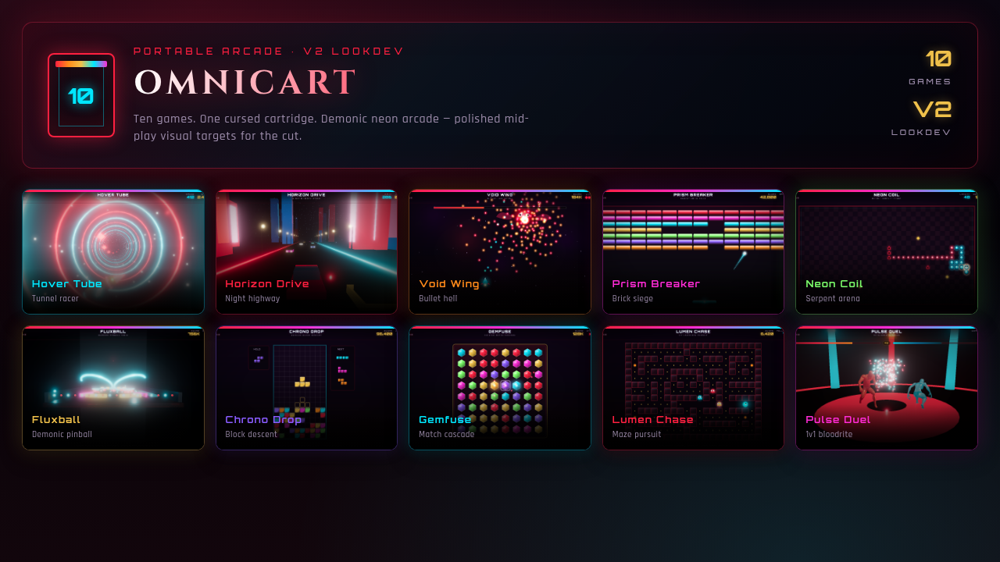

## The Ten

| | | |
|---|---|---|
| 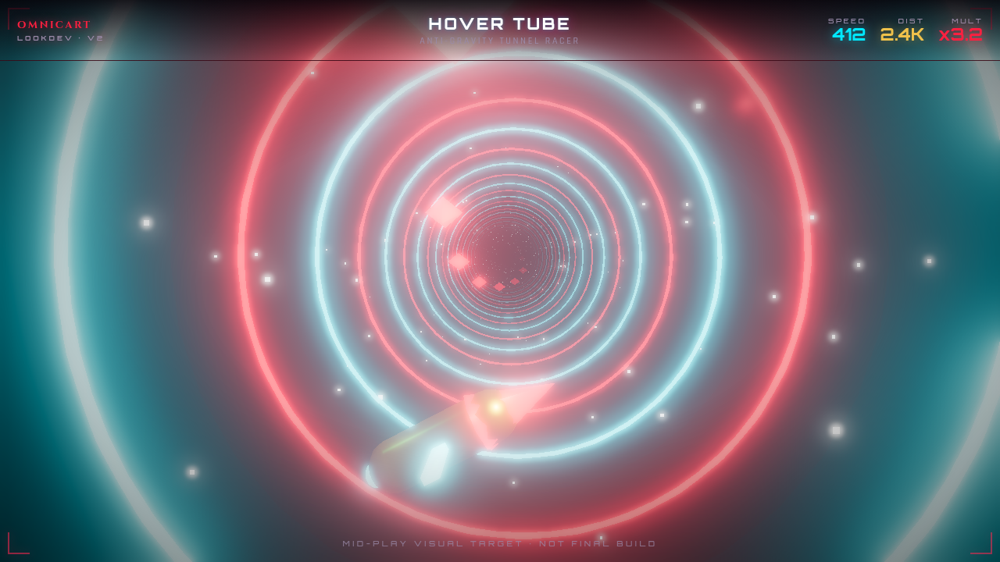 **Hover Tube** — anti-gravity tunnel racer | 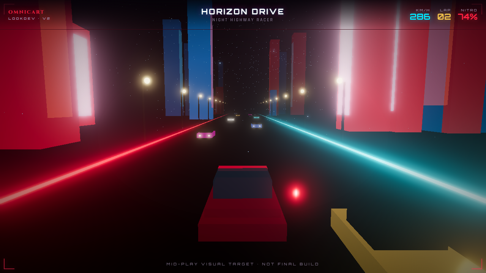 **Horizon Drive** — night highway | 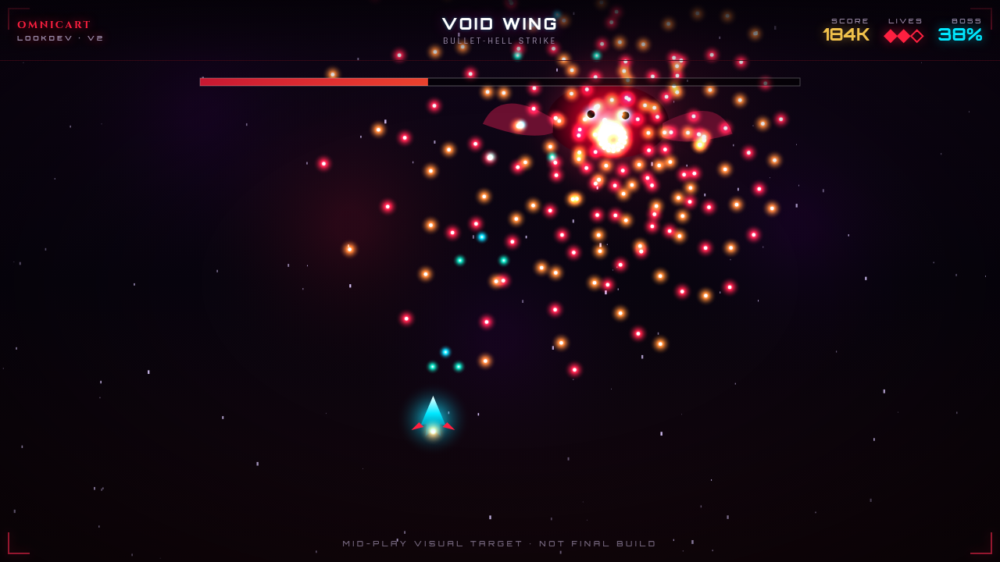 **Void Wing** — bullet hell + bosses |
| 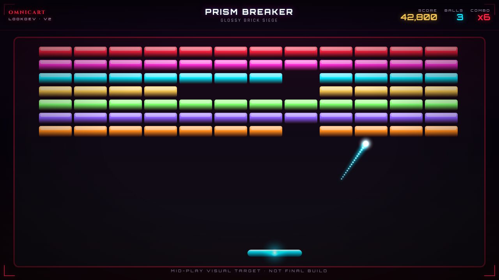 **Prism Breaker** — glossy bricks | 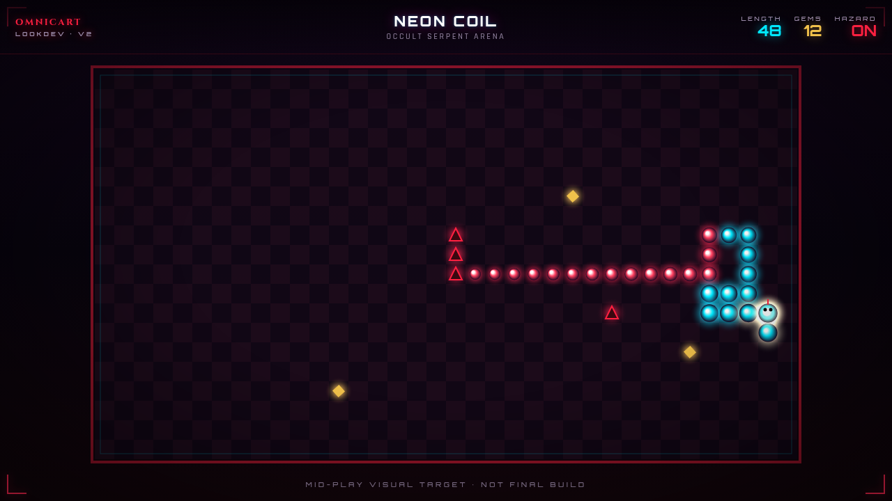 **Neon Coil** — occult snake | 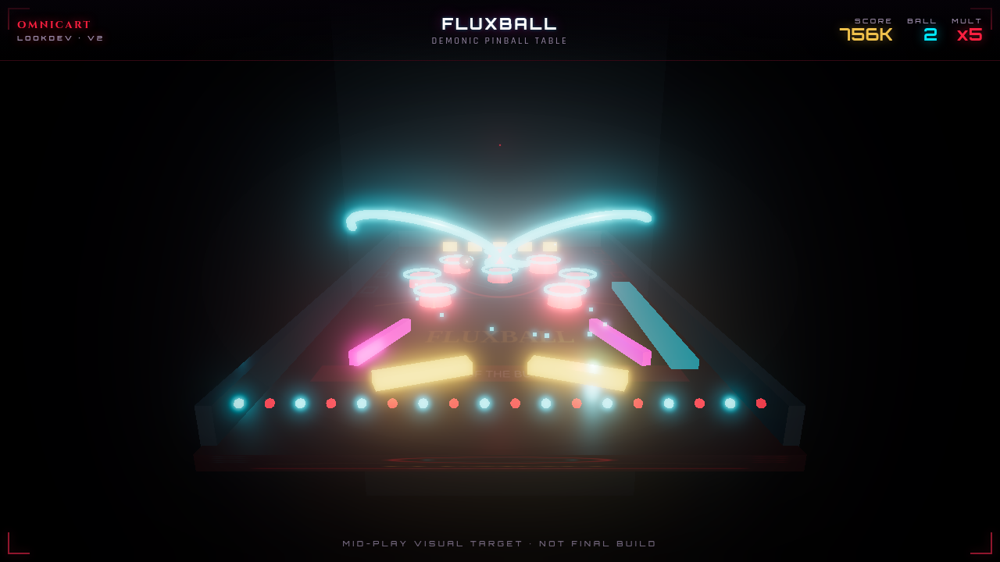 **Fluxball** — demonic pinball |
| 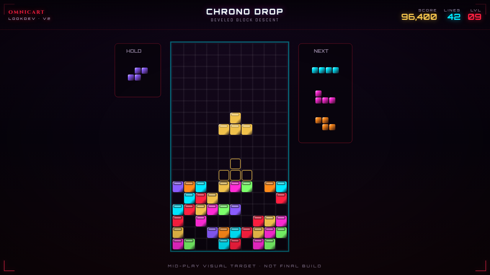 **Chrono Drop** — SRS tetris | 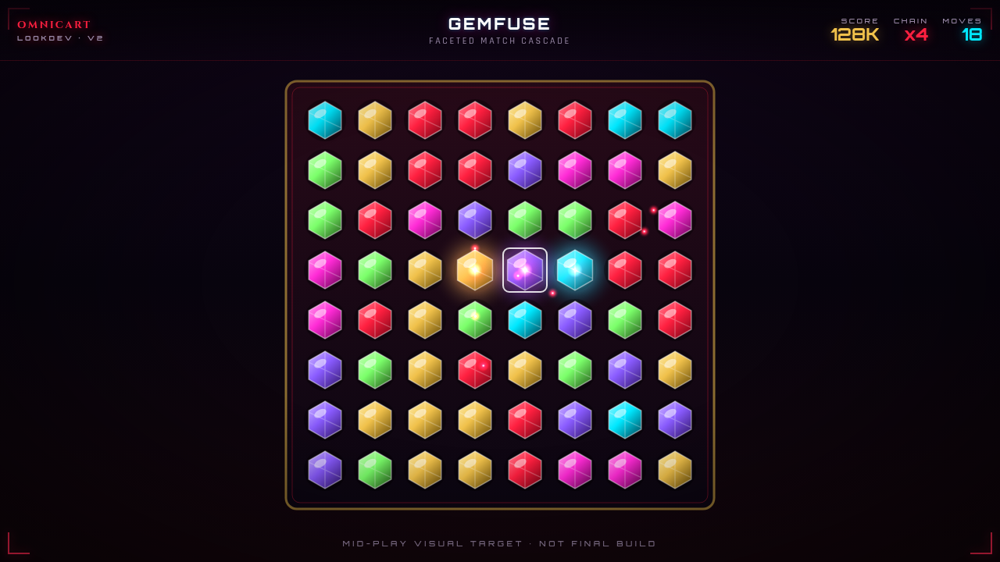 **Gemfuse** — match-3 cascades | 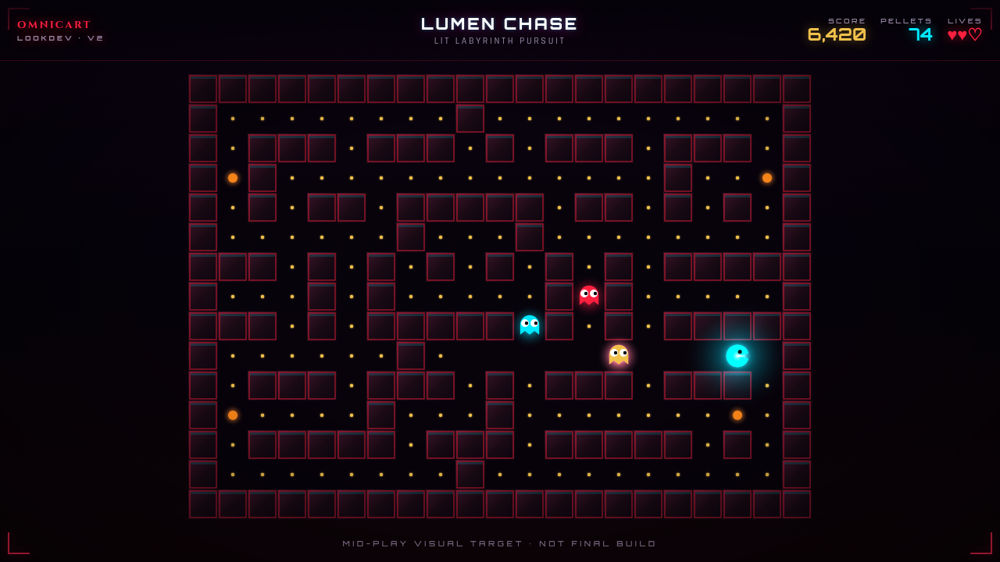 **Lumen Chase** — maze chase |
| 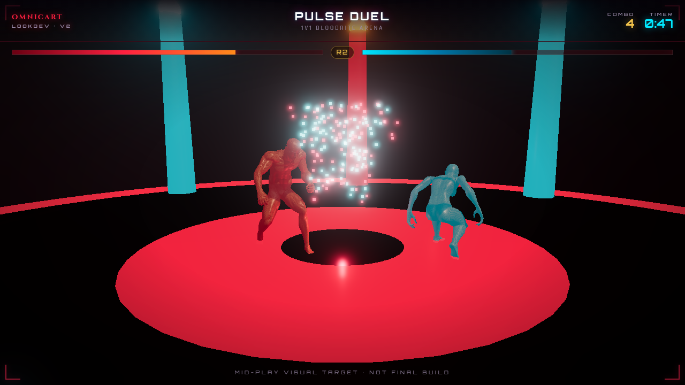 **Pulse Duel** — Quaternius 1v1 fighter | | |

Mobile landscape:

<p>
  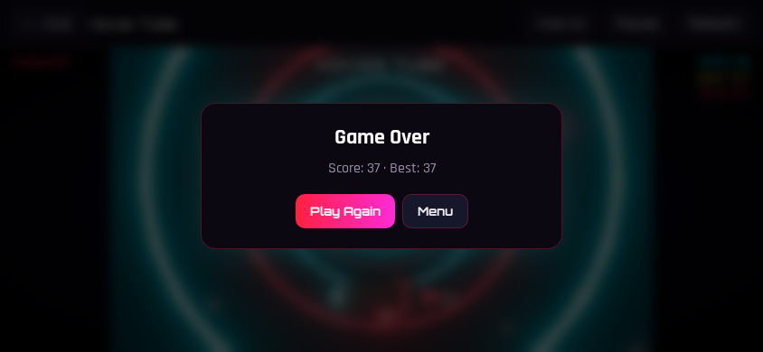
  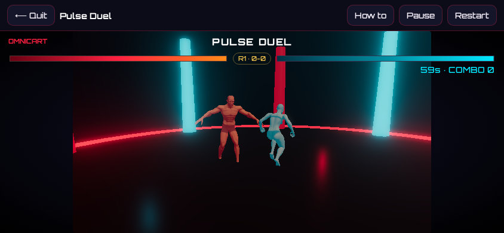
</p>

## Controls

- **Keyboard:** Arrows / WASD · Space / J / K actions · Esc / P pause · C hold (Chrono) · Z/M flippers
- **Touch:** On-screen D-pad + A/B · swipe where it fits · landscape recommended
- **Fighter:** ←/→ move · ↑ jump · J punch · K kick · Shift block

## Tech

- Vite + TypeScript
- Shared `GameBase` / HUD / pause / restart / game-over / settings
- Three.js only for Hover Tube, Horizon Drive, Pulse Duel (bloom scaled down on mobile)
- Quaternius CC0 fighters (from BLOODRITE)
- Each game is a lazy chunk
- Procedural Web Audio SFX + motif music
- Playwright smoke: every game boots, 5s simulated input, no console errors

## Develop

```bash
npm install
npm run dev          # http://localhost:4500
npm run build && npm run preview
npm run test:smoke
npm run screenshots
```

## License

MIT © Death / xDi8blox
